# 08 – Dashboard "Kubernetes Resource Review"

Tài liệu này mô tả dashboard sinh ra từ [dashboards/resource-review.libsonnet](../dashboards/resource-review.libsonnet), dạng JSON nằm ở [generated/resource-review.json](../generated/resource-review.json):
- dashboard hiển thị những gì;
- mỗi panel được tính ra sao;
- cách đọc từng panel.

Nguồn dữ liệu là các recording rule ở [07-recording-rules.md](07-recording-rules.md).

## 1. Thông tin chung

| Thuộc tính | Giá trị |
|---|---|
| Tiêu đề | Kubernetes Resource Review |
| UID | `learnk8s-resource-review` (đường dẫn `/d/learnk8s-resource-review/...`) |
| Thư mục | `Kubernetes` (khi cài qua sidecar) |
| Khoảng thời gian mặc định | **7 ngày gần nhất** (`now-7d` → `now`). Có sẵn các lựa chọn 1h, 6h, 24h, 7d, 14d, 30d |
| Tự làm mới | 1 phút (có thể chọn 30s, 1m, 5m) |
| Cho sửa trên giao diện | Không (`editable: false`). Muốn sửa thì sửa Jsonnet rồi render lại |
| Số panel | 20: 7 stat, 7 biểu đồ, 5 bảng chi tiết, 1 bảng findings |
| Link đầu trang | "Read the Kubernetes Rightsizing guide" (sách hướng dẫn quy trình review) và "Metric definitions and limitations" (`docs/metrics.md`) |

Dashboard **không đưa ra khuyến nghị**. Mô tả của dashboard ghi rõ: *"Revision-safe evidence ... This dashboard does not make resource recommendations."*

## 2. Bộ lọc (biến)

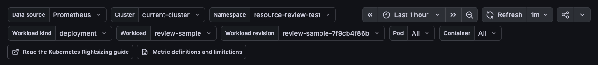

Các biến lọc **theo tầng**: biến sau chỉ hiện các giá trị nằm trong lựa chọn của biến trước. Mọi biến (trừ datasource và cluster) đều lấy giá trị từ `label_values(resource_review:workload_revision_pod_container_info, ...)`.

| Biến | Nhãn hiển thị | Chọn nhiều | Có "All" | Lấy giá trị từ |
|---|---|---|---|---|
| `datasource` | Data source | – | – | Các datasource Prometheus, mặc định chọn datasource tên `Prometheus` |
| `cluster` | Cluster | – | – | Cluster đơn: một giá trị cố định `current-cluster`, chỉ để hiển thị. Đa cluster (`showMultiCluster: true`): lấy từ nhãn `cluster` |
| `namespace` | Namespace | Không | **Không** | namespace có trong rule danh tính |
| `workload_type` | Workload kind | Không | **Không** | Loại workload trong namespace đã chọn |
| `workload` | Workload | Không | **Không** | Tên workload |
| `revision` | Workload revision | Không | Có | ReplicaSet, Job hoặc Pod UID |
| `pod` | Pod | Không | Có | Pod thuộc các revision đã chọn |
| `container` | Container | Không | Có | Container |

**Hệ quả:**
- Mỗi lần xem chỉ được **một workload**. Đây là chủ đích: dashboard dùng để review từng workload một, không phải để xem tổng quan cả cluster.
- Muốn so sánh revision cũ và revision mới thì để `Workload revision = All`.
- Danh sách chỉ gồm những gì **rule danh tính đã từng ghi**. Workload chưa có Pod chạy kể từ lúc cài mixin sẽ không xuất hiện.

## 3. Bố cục

Lưới của Grafana rộng 24 cột. Mọi panel đều hiện sẵn, không có hàng nào bị thu gọn. Thứ tự là: **ngữ cảnh → biểu đồ → bảng chi tiết → bảng tổng hợp → findings**.

```
y=0   ┌Current┬Pod exe-┬Revis-┬Nodes ┬Shortest  ┬CPU       ┬Mixed image ┐  7 stat, cao 3
      │Pods   │cutions │ions  │      │history   │coverage  │groups      │
y=3   ├───────┴────────┴──────┴──────┼──────────┴──────────┴────────────┤
      │ CPU usage, request, limit     │ Memory usage, request, limit     │  cao 10
y=13  ├──────────────┬────────────────┼───────────────┬──────────────────┤
      │CPU throttled │CPU throttled   │CPU pressure   │Memory pressure   │  cao 7
      │periods       │time            │(PSI)          │(PSI)             │
y=20  ├──────────────┴────────────────┼───────────────┴──────────────────┤
      │ Memory breakdown: WSS/RSS/cache│ OOM and restart activity         │  cao 8
y=28  ├────────────────────────────────┴──────────────────────────────────┤
      │ Current workload revisions and configuration                      │  cao 6
y=34  ├───────────────────────────────────────────────────────────────────┤
      │ CPU usage, throttling, and pressure by Pod and node               │  cao 8
y=42  ├───────────────────────────────────────────────────────────────────┤
      │ Memory, OOM events, and restarts by Pod and node                  │  cao 8
y=50  ├───────────────────────────────────────────────────────────────────┤
      │ Workload revision and container review                            │  cao 11
y=61  ├───────────────────────────────────────────────────────────────────┤
      │ Review findings                                                   │  cao 9
y=70  └───────────────────────────────────────────────────────────────────┘
```

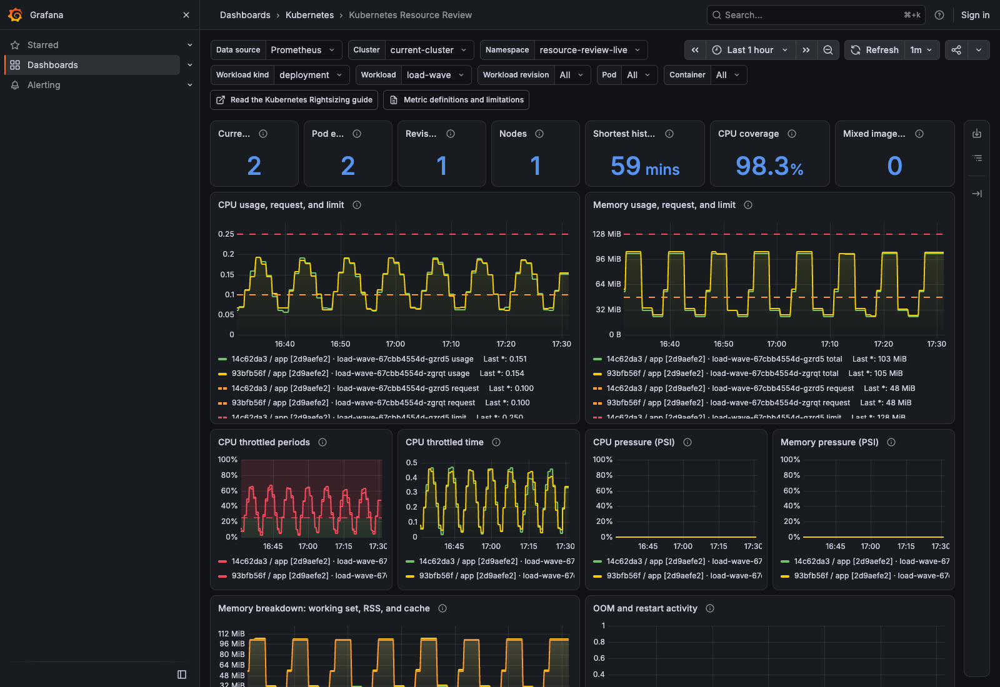

## 4. Các quy ước tính toán chung

Nắm các quy ước này thì đọc panel nào cũng hiểu.

| Quy ước | Cách làm | Ý nghĩa |
|---|---|---|
| **Cửa sổ thời gian** | Bảng và stat dùng instant query với `[$__range]` | Mọi giá trị trong bảng (avg, p95, max, số restart...) được tính trên **đúng khoảng thời gian đang chọn** |
| **Từng Pod trước, gộp sau** | Tính `p95`, `max` trên từng series (Pod UID + container) trước, rồi mới `max by` lên revision | Một replica bất thường không bị số trung bình che đi |
| **Phân biệt thiếu, bằng 0, chưa cấu hình** | Không có series thì để trống; có series bằng 0 thì hiện 0; có cảnh báo riêng cho từng trường hợp | Ô trống **không có nghĩa là 0** |
| **Hàm theo thời gian** | `last_over_time` cho request/limit, `avg_over_time`, `max_over_time`, `quantile_over_time(0.95)` cho mức dùng | Request/limit là giá trị **cuối cùng** trong cửa sổ, mức dùng là thống kê trên **cả cửa sổ** |
| **History** | `count_over_time(cpu_usage[$__range]) × 60` | Rule chạy mỗi phút, nên số mẫu × 60 = số giây đã quan sát |
| **Coverage** | `số mẫu / (độ dài cửa sổ tính bằng phút)`, tối đa 1 | 100% nghĩa là có đủ mẫu cho cả cửa sổ |
| **Chú thích biểu đồ** | `{{pod_execution}} / {{container}} [{{image_digest}}] · {{pod}}` | `pod_execution` là **8 ký tự đầu của Pod UID**, `image_digest` là 8 ký tự đầu của sha256. Hai Pod trùng tên vẫn phân biệt được |
| **Màu ngưỡng** | Throttled > 25% tô đỏ (`cpuThrottledWarningRatio`) | Chỉ để làm nổi bật. Không phải kết luận |

## 5. Hàng 1 – Ngữ cảnh và độ tin cậy của dữ liệu (7 stat)

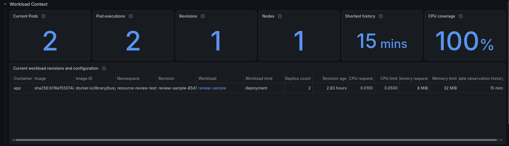

Hàng này trả lời câu hỏi: **dữ liệu bên dưới có đủ để kết luận không?** Stat nào không có dữ liệu sẽ hiện chữ cam "No evidence".

| Id | Panel | Cách tính | Cách đọc |
|---|---|---|---|
| 19 | **Current Pods** | Số Pod UID **ngay lúc này** trong rule danh tính | Không phải số replica mong muốn hay số Pod Ready. Chỉ là số Pod đang được báo cáo |
| 12 | **Pod executions** | Số Pod UID **đã từng xuất hiện** trong cửa sổ | Lớn hơn Current Pods nghĩa là đã có Pod bị thay (rollout, restart node, scale) |
| 18 | **Revisions** | Số revision khác nhau trong cửa sổ | Lớn hơn 1 nghĩa là cửa sổ có rollout. Nên so sánh các revision với nhau. Với StatefulSet hay DaemonSet, con số này bằng số Pod vì revision chính là Pod UID |
| 17 | **Nodes** | Số node đã chạy các Pod | Bằng 1 thì không phát hiện được khác biệt do node gây ra |
| 14 | **Shortest history** | `min(History)` của các replica | Replica được quan sát **ít nhất** có bao nhiêu dữ liệu. Thấp thì p95 và max chưa đáng tin |
| 15 | **CPU coverage** | `min(Coverage)` | Dưới 80% nghĩa là thiếu mẫu (scrape hỏng, Pod mới). Replica không có mẫu nào tính là 0% |
| 16 | **Mixed image groups** | Số nhóm (revision, container) có **hơn một `image_id`** | Lớn hơn 0 (màu cam) nghĩa là cùng một revision chạy nhiều image khác nhau, ví dụ do dùng tag `latest` rồi bị pull lại. Số liệu của nhóm đó là trộn |

## 6. Hàng 2 đến 4 – Biểu đồ theo thời gian

Mọi biểu đồ đều vẽ **mỗi Pod và container một đường riêng**: không xếp chồng, có tooltip nhiều series, chú thích hiện giá trị cuối cùng.

### 21 – CPU usage, request, and limit (rộng 12, cao 10)

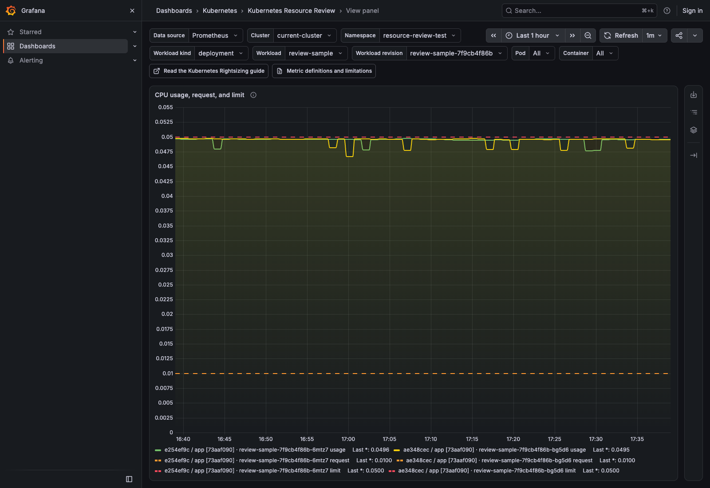

- **Đường liền:** CPU dùng thực tế, trung bình 5 phút (rule ④), đơn vị core.
- **Nét đứt màu cam:** request (⑬). **Nét đứt màu đỏ:** limit (⑭).
- **Cách đọc:**
  - Usage thường xuyên nằm trên request: Pod đang dựa vào CPU dư của node.
  - Usage bị "cắt phẳng" ngay dưới limit: rất có thể đang bị throttle, xem panel 23.
  - Không có đường request hoặc limit: chưa cấu hình.

### 31 – Memory usage, request, and limit (rộng 12, cao 10)

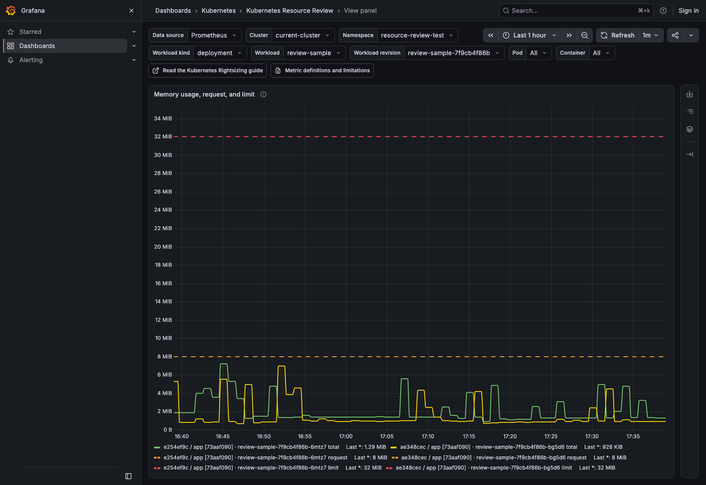

- **Đường liền:** tổng memory của container (⑧), gồm cả page cache.
- **Nét đứt màu cam / đỏ:** request (⑮) / limit (⑯).
- **Cách đọc:**
  - Hình răng cưa, mỗi lần sập xuống ngay sau khi chạm limit: dấu hiệu OOMKilled.
  - Đường tăng đều không giảm: có thể rò rỉ bộ nhớ, so với panel 32 để xem phần tăng là cache hay RSS.

### 23 – CPU throttled periods (rộng 6, cao 7)

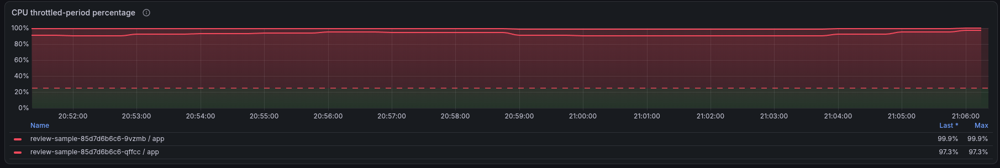

- Tỉ lệ chu kỳ CFS bị throttle (⑤), từ 0 đến 100%. Vùng trên 25% tô đỏ.
- Chứng minh **limit đang được thực thi**. Chưa đủ để chứng minh ứng dụng bị ảnh hưởng.
- Container không có CPU limit thì không có đường nào.

### 24 – CPU throttled time (rộng 6, cao 7)

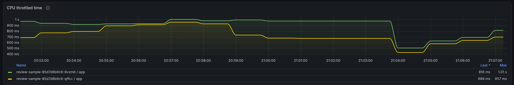

- Số giây bị throttle trên mỗi giây thực (⑥). Ứng dụng nhiều luồng có thể vượt 1.
- Panel 23 cho biết **có bị** throttle hay không, panel 24 cho biết **bị nặng đến đâu**.

### 25 – CPU pressure (PSI) và 36 – Memory pressure (PSI) (rộng 6, cao 7)

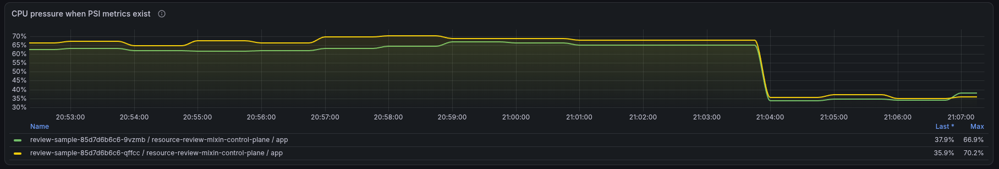

- 25: tỉ lệ thời gian tác vụ phải chờ CPU (⑦). 36: tỉ lệ thời gian bị kẹt vì kernel đang thu hồi bộ nhớ (⑫).
- Chú thích có thêm `{{node}}`, vì pressure thường do node gây ra.
- **Không có dữ liệu nghĩa là môi trường không hỗ trợ PSI**, không có nghĩa là bằng 0.
- PSI không cho biết nguyên nhân là do limit hay do node đang tranh chấp tài nguyên.

### 32 – Memory breakdown: working set, RSS, and cache (rộng 12, cao 8)

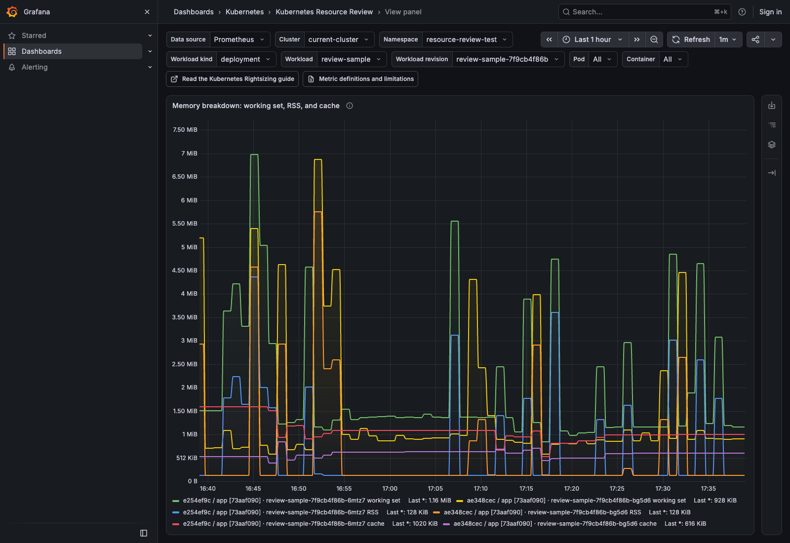

- Ba đường cho mỗi container: working set (⑨), RSS (⑩), cache (⑪). **Không xếp chồng**, vì các con số này chồng lấn nhau.
- **Cách đọc:**
  - Working set gần bằng RSS: memory chủ yếu là heap của ứng dụng.
  - Cache lớn: có thể thu hồi được, thường không phải nguyên nhân OOM.

### 37 – OOM and restart activity (rộng 12, cao 8)

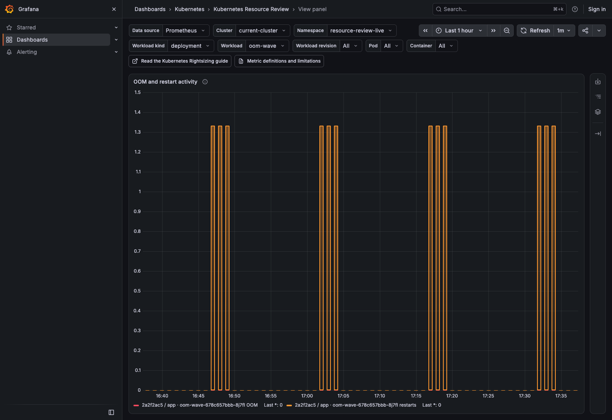

- Dạng **cột**:
  - Cột đỏ: số OOM event mới theo cAdvisor (⑲).
  - Cột cam: số restart mới (⑰).
- Tính bằng `increase(...[$__rate_interval])`, khoảng tối thiểu 4 phút.
- Đây là **số ước lượng theo từng khoảng**, không phải thời điểm chính xác hay tổng của cả cửa sổ. Tổng chính xác nằm ở bảng 42.

## 7. Hàng 5 đến 7 – Bảng chi tiết

Các cột chung: **Revision, Pod, Container, Node**.
- Click vào **Pod**, **Node** hoặc **Workload** sẽ mở dashboard tương ứng của kubernetes-mixin (Pod, Node, Workload) với bộ lọc điền sẵn. Các dashboard này phải có trong Grafana thì link mới hoạt động.
- Các cột namespace, workload, UID, image được ẩn vì đã có ở bộ lọc.

### 9 – Current workload revisions and configuration (rộng 24, cao 6)

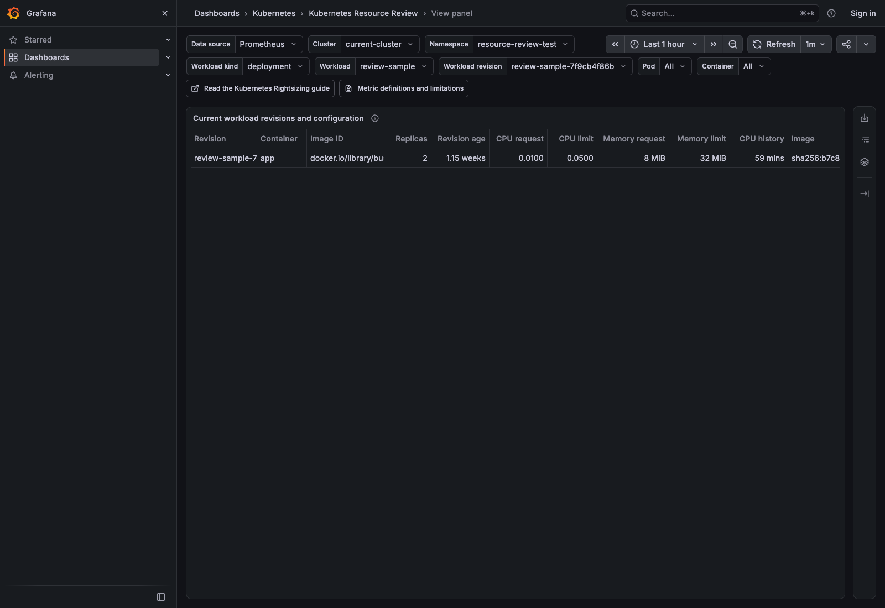

Mỗi dòng là một tổ hợp **revision, container, image** đang chạy. Bảng này trả lời: **hiện đang cấu hình thế nào?**

| Cột | Cách tính |
|---|---|
| Revision, Container, Image ID, Image | Từ rule danh tính ② |
| Replicas | Số Pod UID hiện tại của revision |
| Revision age | `time() - min(thời điểm tạo Pod)` (③), tức Pod cũ nhất của revision đã chạy bao lâu |
| CPU request / CPU limit | Giá trị hiện tại (core) |
| Memory request / Memory limit | Giá trị hiện tại (byte) |
| CPU history | History ngắn nhất trong các replica hiện tại |

### 41 – CPU usage, throttling, and pressure by Pod and node (rộng 24, cao 8)

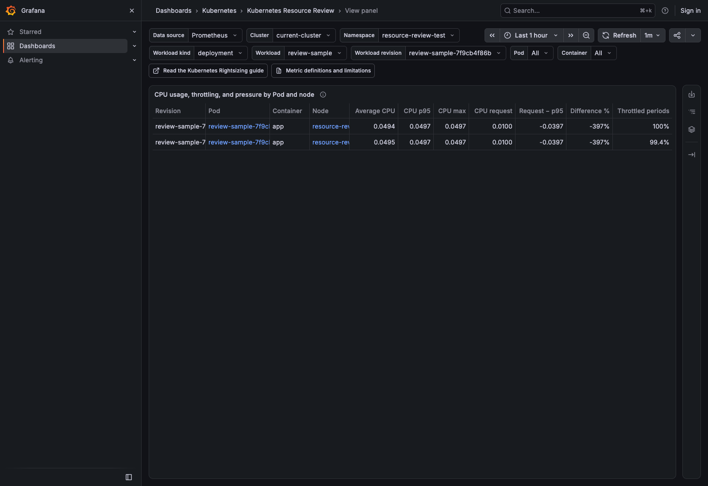

Mỗi dòng là **một Pod và một container**. Mọi số liệu được tính trên cửa sổ đang chọn.

| Cột | Cách tính |
|---|---|
| Average CPU / CPU p95 / CPU max | `avg`, `quantile 0.95`, `max` của ④ |
| CPU request | Request cuối cùng trong cửa sổ |
| Request − p95 | `request - p95`, chỉ tính khi request > 0. **Âm** nghĩa là p95 vượt request |
| Difference % | `(request - p95) / request`. Ví dụ −397% nghĩa là p95 gần gấp 5 lần request |
| Throttled periods / Throttled time | Giá trị lớn nhất của ⑤ và ⑥ |
| CPU pressure | Giá trị lớn nhất của ⑦ |
| History / Coverage | Thời gian đã quan sát và độ phủ mẫu của **chính Pod đó** |

### 42 – Memory, OOM events, and restarts by Pod and node (rộng 24, cao 8)

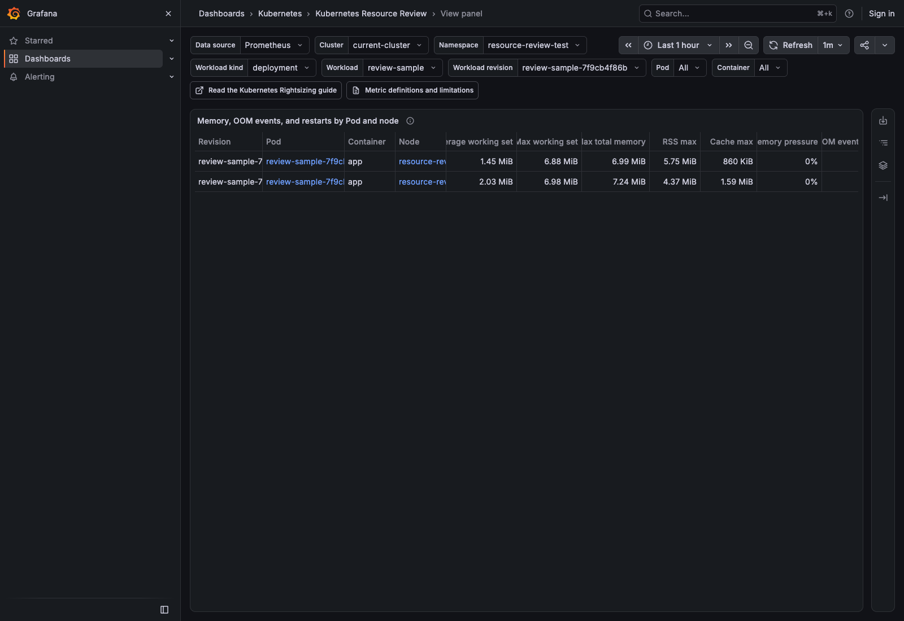

| Cột | Cách tính |
|---|---|
| Average working set / Max working set | `avg`, `max` của ⑨ |
| Max total memory | `max` của ⑧ |
| RSS max / Cache max | `max` của ⑩ và ⑪ |
| Memory pressure | `max` của ⑫ |
| OOM events | `increase(⑲[$__range])`: tổng số OOM event trong cửa sổ |
| Restarts | `sum without (image, image_id) (increase(⑰[$__range]))` |
| OOMKilled | `max_over_time(⑱)`, hiện dạng **True / False** |

## 8. Hàng 8 – Bảng review theo revision

### 51 – Workload revision and container review (rộng 24, cao 11)

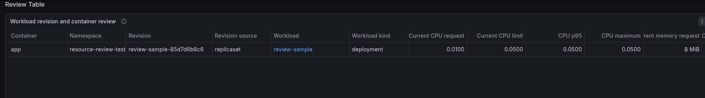

Đây là **bảng chính để ra quyết định**. Mỗi dòng là một tổ hợp **revision và container**, gộp tất cả replica của revision đó. Cách gộp là lấy `max` trên các giá trị đã tính cho từng Pod, nên dòng tổng hợp phản ánh **replica nặng nhất**, không phải trung bình. Bảng có 22 query được ghép lại.

| Nhóm | Cột | Cách tính |
|---|---|---|
| Chất lượng dữ liệu | **Image population** | Số `image_id` khác nhau. `0` = "Unknown images" (cam), `1` = "1 known image" (xanh), `≥2` = "Mixed images" (cam) |
| | **Warnings** | Số loại cảnh báo thiếu bằng chứng của dòng này (xem §9) |
| | Replicas | Số Pod UID đã chạy revision này trong cửa sổ |
| | CPU history | History ngắn nhất trong các replica |
| CPU | CPU request / CPU limit | Giá trị cuối cùng |
| | CPU p95 / CPU max | `max` trên các Pod của p95 / max từng Pod |
| | CPU difference / CPU difference % | `request − p95` và tỉ lệ so với request |
| Memory | Memory request / Memory limit | Giá trị cuối cùng |
| | Memory max | `max` của tổng memory (⑧) |
| | Memory difference / Memory difference % | `request − max` và tỉ lệ so với request |
| Runtime | OOM events / Restarts | Tổng trong cửa sổ |
| | OOMKilled | Có ít nhất một Pod từng bị OOMKilled |
| | Throttled periods / Throttled time | `max` |
| | CPU pressure / Memory pressure | `max` |

**Lưu ý khi đọc:**
- Cột difference dương và lớn cho thấy request đang **dư so với mức dùng đã quan sát**. Theo nguyên tắc của dự án, đây **không** phải bằng chứng rằng giảm request là an toàn. Còn phải xét cửa sổ đủ dài chưa, đỉnh tải theo tuần, lúc khởi động, và cột Warnings.
- CPU dùng p95, còn memory dùng max, vì memory không thể bị throttle: chạm limit là bị kill.
- Dòng có "Mixed images" chứa số liệu trộn từ nhiều image.

## 9. Cảnh báo thiếu bằng chứng (cột Warnings)

Cột Warnings của bảng 51 đếm số loại cảnh báo **khác nhau** cho mỗi dòng. Danh sách đầy đủ 20 loại cảnh báo:

| Nhóm | Cảnh báo | Khi nào xuất hiện |
|---|---|---|
| Thiếu số liệu mức dùng | CPU usage unavailable | Pod có trong danh tính nhưng không có ④ |
| | CPU throttled-period evidence unavailable | Không có ⑤, thường do không đặt CPU limit |
| | CPU throttled-time evidence unavailable | Không có ⑥, thường do chart đã bỏ metric gốc |
| | Total memory unavailable / Memory working set unavailable / Memory RSS unavailable / Memory cache unavailable | Thiếu ⑧, ⑨, ⑩, ⑪ |
| | CPU PSI unavailable (optional) / Memory PSI unavailable (optional) | Môi trường không có PSI |
| | cAdvisor OOM counter unavailable | Không có ⑲ |
| | Restart counter unavailable | Không có ⑰ |
| Cấu hình | CPU request not configured / CPU limit not configured / Memory request not configured / Memory limit not configured | Không có series request hoặc limit |
| | CPU request is zero; ratio omitted / Memory request is zero; ratio omitted | Request bằng 0, nên cột % bị bỏ trống |
| Danh tính | Revision falls back to Pod UID | `revision_source="pod_uid"` (StatefulSet, DaemonSet, Pod trần...) |
| | Multiple immutable images in one revision | Image population ≥ 2 |
| Độ phủ | CPU sample coverage below 80% | Pod thiếu hơn 20% số mẫu CPU trong cửa sổ |

Dashboard chỉ hiện **con số đếm**, không liệt kê tên cảnh báo. Muốn xem tên cụ thể, mở panel 51 bằng **Inspect → Query** hoặc **Explore**, xem query `AA` để biết dòng nào có cảnh báo gì.

## 10. Hàng 9 – Review findings (panel 59, rộng 24, cao 9)

Panel được bổ sung ở tầng 1 (xem [03](03-plan-tier1-findings.md), [04](04-progress-log.md), [docs/findings.md](../docs/findings.md)).

| Cột | Ý nghĩa |
|---|---|
| Revision, Container | Dòng nào có finding |
| Finding | Mã finding, ví dụ `cpu-limit-constrained` |
| What to check next | Việc cần kiểm tra tiếp, bằng tiếng Anh |
| Severity | 1 = Info (xanh), 2 = Warning (cam), 3 = Critical (đỏ) |

11 finding, cách tính chi tiết có trong docs/findings.md:

| Finding | Mức | Điều kiện (tóm tắt) |
|---|---|---|
| `memory-oom-killed` | Critical | Có Pod bị OOMKilled hoặc có OOM event trong cửa sổ |
| `cpu-limit-constrained` | Warning | p95 tỉ lệ throttle > 25% |
| `memory-near-limit` | Warning | Max memory tổng > 80% limit (và chưa bị OOM) |
| `memory-trending-to-limit` | Warning | Working set tăng đều, ngoại suy sẽ chạm limit trong một cửa sổ nữa, và Pod có ≥ 80% số mẫu |
| `memory-usage-above-request` | Warning | p95 working set > request |
| `best-effort` | Warning | Pod có QoS BestEffort |
| `cpu-usage-above-request` | Info | p95 CPU > request (và không bị throttle nặng) |
| `cpu-request-far-above-usage` | Info | Mọi replica có p95 CPU < 30% request, và có ≥ 7 ngày lịch sử với ≥ 80% số mẫu |
| `memory-request-far-above-usage` | Info | Mọi replica có max working set < 30% request, cùng điều kiện lịch sử như trên |
| `replica-imbalance` | Info | Replica bận nhất có p95 CPU gấp > 2 lần replica rảnh nhất, và có ≥ 2 Pod |
| `restarts-without-oom` | Info | Có restart nhưng không có dấu hiệu OOM |

Findings được tính **ngay trong query** của panel nên không tốn thêm series. Các ngưỡng nằm trong `config.libsonnet`. Bảng trống có thể có hai nghĩa:
- không có dấu hiệu nào;
- **chưa đủ dữ liệu**: findings về mức dùng thấp cần ít nhất 7 ngày.

## 11. Cách đọc dashboard theo thứ tự đề xuất

1. **Chọn workload** và để khoảng thời gian **ít nhất 7 ngày**, bao gồm cả đỉnh tải theo tuần.
2. **Hàng stat:** xem Shortest history và CPU coverage có đủ không, Mixed image groups có bằng 0 không. Chưa đủ thì dừng ở đây, chưa kết luận gì.
3. **Review findings (59):** xem có Critical hoặc Warning nào không. Mỗi finding chỉ ra panel nên xem tiếp.
4. **Bảng review (51):** so sánh các revision với nhau. Chú ý cột Warnings và Image population.
5. **Bảng theo Pod (41, 42):** tìm replica bất thường, xem có node nào lặp lại không.
6. **Biểu đồ (21–37):** xem hình dạng theo thời gian để xác nhận: đỉnh tải theo lịch, răng cưa OOM, cắt phẳng do throttle.
7. **Quyết định** request/limit mới là việc của người vận hành. Sau khi rollout, revision mới hiện thành một dòng riêng trong bảng 51 để so sánh với revision cũ.

## 12. Khi dashboard trống

| Hiện tượng | Nguyên nhân thường gặp |
|---|---|
| Danh sách Namespace rỗng | Rule ② không có dữ liệu: rule chưa được nạp, hoặc selector `job=` không khớp. Chạy [diagnose.sh](diagnose.sh) |
| Có danh sách nhưng biểu đồ CPU/memory trống | cAdvisor không có nhãn `container`/`image` (runtime docker), hoặc `cadvisorSelector` sai |
| Chỉ panel 24 trống | Metric `container_cpu_cfs_throttled_seconds_total` bị chart bỏ |
| Panel 25 và 36 trống | Môi trường không có PSI (bình thường) |
| Stat hiện "No evidence" | Không có dữ liệu trong cửa sổ đang chọn. Thử mở rộng khoảng thời gian |
| Findings trống ở cluster mới | Findings về mức dùng thấp cần ≥ 7 ngày dữ liệu |
